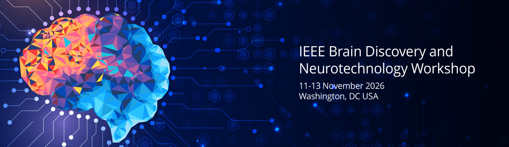
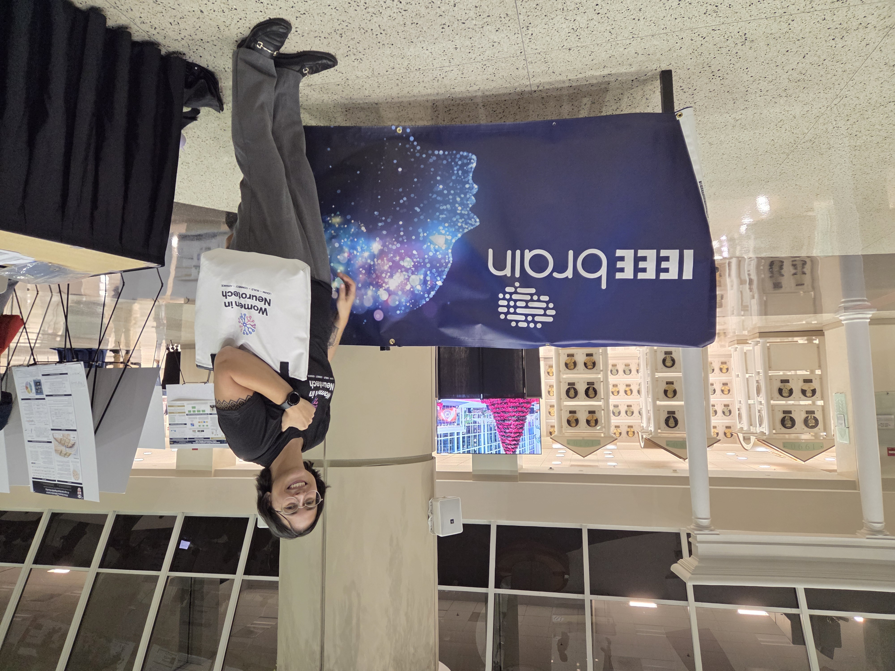
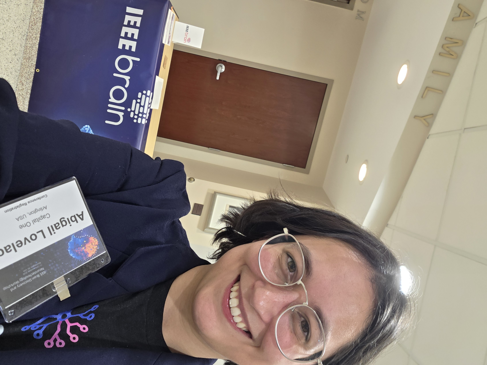

# Sat, 11.14.26 - Next Steps

I have been thinking and planning for this project but honestly it kinda got shoved in the closet for a couple months. 

In my defense, I did go to [Iceland](https://itinerary.abigaillovelace.com/) and this is not a project you can travel internationally with.

## The Motivation
I had the chance to the 2026 IEEE Brain Discovery & Neurotechnology Workshop in Washington D.C. this week and it gave me so many ideas and plans for this project! 

The conference was an excellent experience, even for a humble hobbyist! As a former computer engineer turned software engineer, I really enjoyed the Machine Learning and Computer Paradigms for Brain Discovery track. Dr. Frances Chance's talk on neuromorphic computing was so amazing! Who knew that simulating the circuitry of a fruit fly's brain could give us a whole new set of movement sensors? I met some really great people as well. I learned so much from the student posters and really enjoyed discussing their research. I will definitely be going next year.

I was honored to represent [Women in Neurotech](https://www.womeninneurotech.org/) while I was there too! Shout out to Shannon for sending me some merch so I could rep our awesome org.

## The PLANS
So now I have *plans*. The first thing I heard frequently from attendees who actually know what they're doing with EEG is that I need to upgrade my electrodes. Apparently using electrodes from 7ish years ago that I'm pretty sure are actually single use (I have not been single using them) are probably not going to be effective.

- [] Upgrade the electrodes

OMG electrodes are **expensive**. I'll probably get 3-4 since I'm interested in low channel methods anyways. On the plus side, this does give me an interesting opportunity to explore electrode types. I'd like to go for reusable, dry, brush style electrodes like the ones from [biopac](https://www.biopac.com/product/reusable-dry-electrode-flex/). I also ran across a really great product by a company called [synaptive](https://www.linkedin.com/company/synaptiveltd/) that creates EEG electrodes that work for curly hair. 

My first step will just be to order some conductive gel so I can use the electrodes I have properly. Still have no idea if they are disposable or not.

Next, I need to make the circuit easier for me to use.

- [] Solder or crimp connectors onto the power sources and probes so it's easier to connect/disconnect things.

I realized one of the reasons I was de-motivated towards this project was that it took so much setup and tear down due to the circuit being active. I didn't want the circuit constantly powered but my battery pack wires are super flimsy so pulling them in and out of the bread board was annoying.

I also want to get some automated testing on startup using my arduino.

- [] Get software at least to the point where it shows the same output as my oscope.

Even without good electrodes, connections, or gel, I can be ready for when I do take the plunge into better components.

- [] Diagram and simulate the circuit

I can't believe I didn't do this before. This is such an obvious first step but ya girl likes putting things on a breadboard so that's what happened. I want to do this so I can get an idea of what the signal "should" be but also this will set me up well for tuning different components. It's much easier to change a value on screen than replace a voltage divider on a breadboard.

Those are the plans! Wish me luck and follow along if you so desire.

